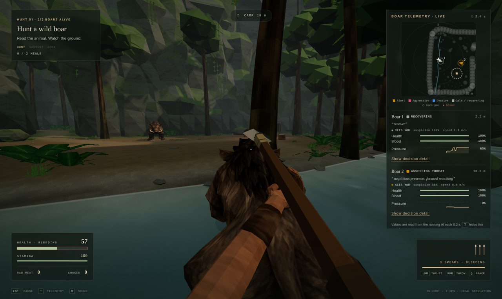
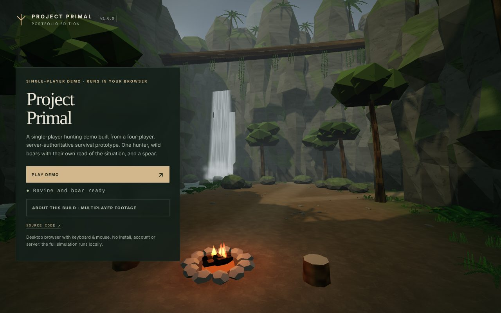
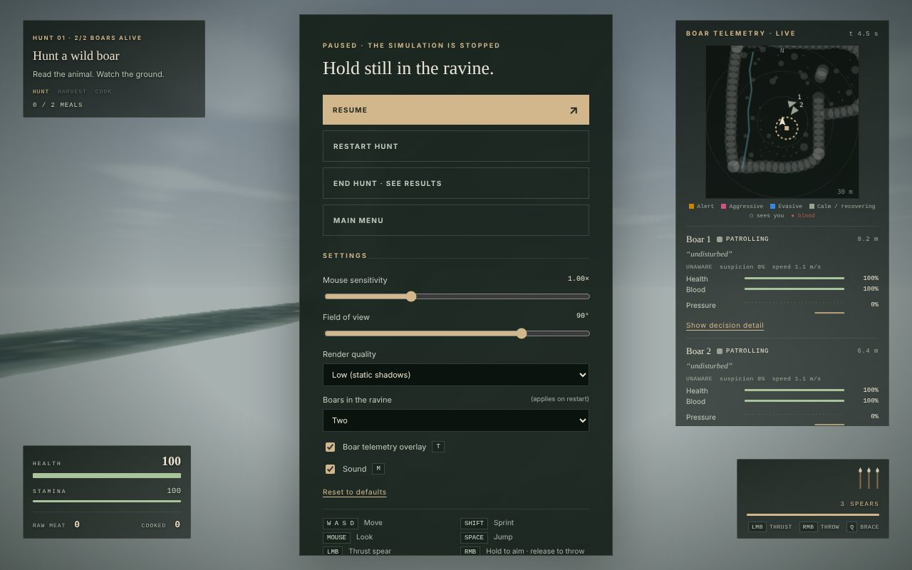
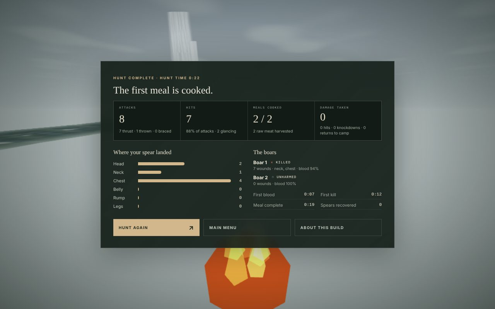

# Project Primal: Portfolio Edition

A playable, single-player prehistoric hunting demo that runs entirely in the browser. It is built with **React 19**, **Three.js** and **Vite 8**, and deployed as a static site on **GitHub Pages**.

The demo is derived from *Primal Co-op* (v0.4.0, Hunt Slice 0.1), a four-player, server-authoritative Node.js/Socket.IO prototype. The original's simulation, boar AI, anatomy and wound model run here **unchanged**, inside the page. A local adapter replaces the network, and React replaces the hand-built DOM interface. There is no backend.

**Live demo:** `https://YOUR-USERNAME.github.io/primal-portfolio/` (after you publish, see below)


*A boar has just charged and gored the hunter (health 57, bleeding) while the second boar assesses the threat 18 m away. The telemetry panel reads both brains live. Screenshots were captured in headless Chrome with software rendering, so they look softer than the game does on a real GPU.*

| Main menu | Pause & settings | Results |
|---|---|---|
|  |  |  |

## What you can do in the demo

1. **Hunt.** Track one or two wild boars through a jungle ravine. Thrust with the spear (LMB), or hold RMB to wind up a throw and release it. Hold Q to brace against a charge.
2. **Harvest.** Press E at the carcass.
3. **Cook.** Return to the campfire and cook two pieces of meat. A results screen then summarises the hunt, and you can hunt again without reloading the page.

The boars perceive you (with line of sight), remember you, weigh pressure and temperament, and then warn, charge, bluff, kick, sweep, flee or break away. Spear hits land on a per-region anatomy. Wound depth drives bleeding, limping and laboured breathing, and those in turn change how a boar behaves. Press **T** for the telemetry panel: each boar's behaviour state, its stated intent, a pressure trend, blood, wounds and recent decisions, plus a top-down tactical map.

## Run it locally

You need Node.js 20.19+ or 22.12+.

```bash
npm ci               # install the versions recorded in package-lock.json
npm run dev          # http://localhost:5173/
npm test             # 200 simulation, AI and client-module tests (Node's built-in runner)
npm run build        # production build in dist/, base path /primal-portfolio/
npm run preview      # serve dist/ at http://localhost:4173/primal-portfolio/
npm run check:dist   # verify dist/ references, base path and size limits
```

`?debug` on the URL exposes `window.__primal`, a small scripting API used by automated browser tests.

## Publish to GitHub Pages

This is its own repository. Nothing needs to change in your existing portfolio site. You only link to the URL.

1. **Create the repository.** On GitHub, go to **New repository**, name it exactly **`primal-portfolio`** and make it **Public**. Leave "Add a README" unticked.
2. **Push this folder.** If you started from the source ZIP, create the local repository and its first commit:
   ```bash
   cd primal-portfolio
   git init -b main
   git add .
   git commit -m "Add Project Primal portfolio edition"
   git remote add origin https://github.com/YOUR-USERNAME/primal-portfolio.git
   git push -u origin main
   ```
3. **Turn on Pages.** In the repository, go to **Settings → Pages → Build and deployment → Source** and choose **GitHub Actions**.
4. **Watch the deploy.** Open the **Actions** tab. The *Deploy to GitHub Pages* workflow installs dependencies, runs the tests, builds, checks the output and publishes. If the first run failed before Pages was enabled, choose **Run workflow**.
5. **Get your URL.** When the run is green, the URL appears on the *deploy* job and under **Settings → Pages**:
   **`https://YOUR-USERNAME.github.io/primal-portfolio/`**
6. **Link it from your portfolio:**
   ```html
   <a href="https://YOUR-USERNAME.github.io/primal-portfolio/" target="_blank" rel="noopener">Play Demo</a>
   ```

Every later push to `main` redeploys automatically.

### Optional settings (no code changes)

Under **Settings → Secrets and variables → Actions → Variables**, you can add any of these repository variables. Then re-run the workflow.

| Variable | Effect |
|---|---|
| `PORTFOLIO_URL` | Adds a "← Portfolio" link back to your main site |
| `MULTIPLAYER_VIDEO_YOUTUBE` | YouTube video ID for the multiplayer footage panel |
| `MULTIPLAYER_VIDEO_FILE` | File name of a video you placed in `public/media/` |
| `MULTIPLAYER_SOURCE_URL` | Link to the original multiplayer repository, if it is public |

The "Source code" link is filled in automatically with this repository's URL. You can also edit everything in `src/config/portfolio.js`.

**Multiplayer video.** Until you configure one, the About page shows a neutral placeholder card, never a broken player. YouTube is the lightest option. If you host the file yourself, use H.264 MP4 under about 50 MB (GitHub rejects files over 100 MB), put it in `public/media/`, and set `MULTIPLAYER_VIDEO_FILE`.

### Hosting limits

The published site is about **7 MB**. The largest file is the 5.9 MB boar model. GitHub Pages allows sites up to 1 GB and files up to 100 MB, with a soft bandwidth limit of 100 GB per month. The original 21 MB human model is not shipped: it only draws *other* hunters, so a single-player build never uses it. `scripts/check-dist.mjs` runs in CI and fails the deploy if a referenced file is missing, uses the wrong base path, or approaches a size limit.

### Troubleshooting

- **Blank page, or 404s for `/assets/...`:** The build used the wrong base path. The workflow derives it from the repository name. For a manual build, use `BASE_PATH=/primal-portfolio/ npm run build`.
- **Custom domain or a `username.github.io` repository:** The site is served from `/`. Build with `BASE_PATH=/`.
- **"Get Pages site failed" in Actions:** Pages is not enabled yet. See step 3.
- **The mouse isn't captured after pressing Esc:** Browsers block re-capturing the pointer for about a second. Click **Resume** again.

## Project layout

```
simulation/   authoritative game state, hunt rules, boar brain, anatomy (copied verbatim from server/)
shared/       movement, terrain, world, hunt constants, protocol (verbatim)
src/game/     Three.js client modules from the original (world, boar rig, first-person spear, …)
src/engine/   GameEngine (the adapted main.js), LocalSimulation, stores, HUD model, telemetry, stats
src/ui/       React components: menu, briefing, about, HUD, telemetry, pause/settings, results
src/config/   portfolio text, links and video slot
tests/        portfolio tests + the original suite (adapted paths)
public/game/  boar model and first-person textures
```

For the full write-up, see [`docs/ARCHITECTURE.md`](docs/ARCHITECTURE.md): the audit findings, data flow, what changed and what was kept, the React features, verification and known limitations. Suggested resume bullets are in [`docs/PORTFOLIO_NOTES.md`](docs/PORTFOLIO_NOTES.md).
